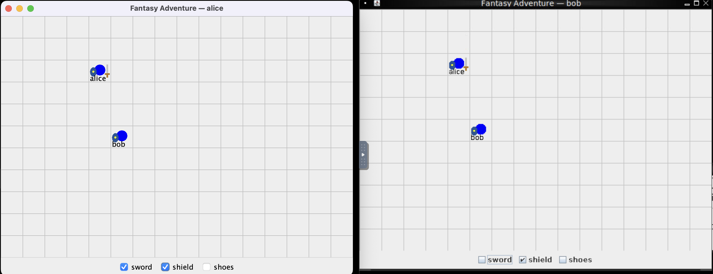

# CSC 3100 — A04 Distributed Fantasy Adventure

[](https://github.com/matthewdaviii/A04-Distributed-Fantasy/actions/workflows/ci.yml?query=branch%3Aa04-integration)

Two Java Swing clients synchronize player movement and equipment through MQTT. One client runs locally, and the other runs in Docker with a browser-accessible noVNC desktop.

## Learning goals

Implement the Factory, Decorator, and Observer patterns. Synchronize two Swing clients through MQTT, verify behavior with JUnit, and use GitHub Actions to test and package the application.

## Setup and tests

Install Java 21, Maven, and Docker Desktop or Docker Engine with Compose. Open a terminal in the project directory and run:

```sh
mvn -v
mvn -B test-compile
mvn -B -Djava.awt.headless=true test
```

Confirm that `mvn -v` reports Java 21. The local suite passed all **61 test cases**, including 58 instructor cases and the three broker-independent tests in `StudentAcceptanceTest.java`.

GitHub Actions runs the full JUnit suite before packaging the executable JAR, building the Docker image, and checking the noVNC endpoint, Java process, and Swing window. The smoke test uses a private MQTT broker.

## Required demonstration



Use the same unique `TEAM` value for both clients and a different `PLAYER` name for each. Replace `your-team` in both commands with your team ID.

1. Open the Maven project in IntelliJ and select JDK 21. Run `edu.calpoly.csc3100.fantasy.Main` with `TEAM=your-team` and `PLAYER=alice`, or launch the same client from IntelliJ’s terminal:

   ```sh
   TEAM=your-team PLAYER=alice mvn exec:java
   ```

2. With Docker running, package the JAR and start Bob in a second terminal:

   ```sh
   mvn -B package
   TEAM=your-team PLAYER=bob docker compose up --build -d
   ```

3. Open [Bob’s noVNC window](http://127.0.0.1:6080/vnc.html?autoconnect=1). Click inside each Swing board before using its arrow keys.

### What to show

- Show Alice and Bob on both boards. They start on the same tile and may overlap until one player moves.
- Move Alice one tile from the local window and verify the update on Bob’s board. Move Bob one tile from the browser and verify the update on Alice’s board.
- Use the equipment checkboxes to add and remove items from both clients. With multiple items equipped, remove one and verify that only its overlay disappears on both boards.
- Show the passing JUnit suite and the successful GitHub Actions run.

When finished, close the local Swing window and run this from the project directory:

```sh
docker compose down
```

## Architecture

- **Factory** creates the Warrior and rebuilds its equipment chain from the player snapshot.
- **Decorator** draws the wrapped character first, then adds the Sword, Shield, or Shoes overlay inside the 40-pixel tile. Sword adds 5 attack, Shield adds 5 defense, and Shoes are visual only.
- **Blackboard** extends `PropertyChangeSupport`, stores player snapshots, and fires `players` events when state changes.
- **Observer** updates the Swing board on the event-dispatch thread.
- **Publisher** sends each changed local snapshot once. **Subscriber** applies valid remote snapshots without republishing them.
- **MQTT** uses `tcp://broker.hivemq.com:1883`, QoS 1, and retained snapshots on `csc3100/a04/<team>/players/<username>`. Retained snapshots show the last reported state, even after a player disconnects.

### Behavior covered by tests

- Arrow keys move the local player one tile on a 16-column by 11-row board. Zero, diagonal, multi-tile, and out-of-bounds moves are ignored.
- Supported equipment IDs are `sword`, `shield`, and `shoes`. Each can be equipped once, and removing an item preserves the order of the others.
- A changed local snapshot produces one observer event and one publish. A changed remote snapshot produces one observer event. An identical remote snapshot produces no event.
- Incoming messages must contain a valid UTF-8 JSON snapshot for a remote player whose name matches the suffix of the correct team topic. Malformed messages are dropped so later snapshots can still be processed.